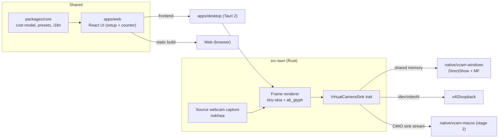

# Architecture

## Overview

## Cost model (packages/core)

- `hourlyRate = annualSalary / hoursPerYear` (`hoursPerYear` default **1800**, user-configurable).
- `totalCost(t) = Σ hourlyRate_i × elapsedHours(t)`.
- `personTime(t) = participants × elapsed(t)`.
- `elapsed(t) = clamp(min(now, endAt) − startAt, 0)`. A start time in the future shows a "starts in" state.
- Counter is computed from timestamps (never accumulated), so every window/frame is consistent and drift-free.

## Web flow

1. Setup page: currency, hours/year, start time, participants (preset role from Spain salary list or custom annual salary).
2. **Start** stores the meeting in `localStorage` and opens the counter window (`#/counter`):
   - Web: `window.open` popup.
   - Desktop: Tauri `WebviewWindow`.
3. Counter window re-renders every animation frame (`requestAnimationFrame`) and listens to `storage` events for live edits.

## Virtual camera (desktop only)

- The counter frame for the camera is rendered **in Rust**, not captured from the webview: no window needed, constant 30 fps, low CPU.
- Modes: `counter only` (solid background) or `overlay` (counter composited on a selected physical webcam).
- One producer (the app) and one platform sink per OS. See [ADR-0002](decisions/0002-virtual-camera.md).
