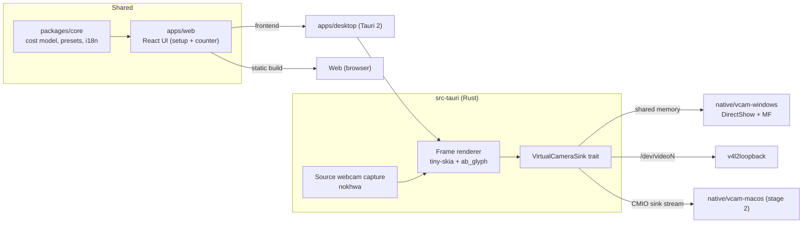

# Architecture

## Overview

## Cost model (packages/core)

- A meeting has a country (ES, PT, FR, DE, IT, NL, GB, US, MX) that sets default currency, hours/year and employer contribution rate ([ADR-0005](decisions/0005-countries-and-total-cost.md)).
- `hourlyRate = annualSalary × (1 + employerCostRate if total cost) / hoursPerYear` (Spain: 1800 h, all user-configurable).
- `totalCost(t) = Σ hourlyRate_i × elapsedHours(t)`.
- `personTime(t) = participants × elapsed(t)`.
- `elapsed(t) = clamp(min(now, endAt) − startAt, 0)`. A start time in the future shows a "starts in" state.
- Counter is computed from timestamps (never accumulated), so every window/frame is consistent and drift-free.

## Web flow

1. Setup page: currency, hours/year, start time, participants (preset role from Spain salary list or custom annual salary).
2. **Start** stores the meeting in `localStorage` and opens the counter window (`#/counter`):
   - Web: `window.open` popup.
   - Desktop: Tauri `WebviewWindow`.
3. Counter window re-renders every animation frame (`requestAnimationFrame`) and listens to `storage` events for live edits.
4. **Share the cost** builds a `#/share?t=…&c=…&m=…&cur=…` link carrying only the aggregate figures (total time, total cost, cost/min) and copies it to the clipboard. `ShareView` decodes and validates it ([ADR-0009](decisions/0009-share-links.md)).

## Counter styles ([ADR-0006](decisions/0006-counter-styles-and-layouts.md))

- Themes (classic, modern, formal, halloween, christmas, 4 seasons, minimalist) are plain data in `packages/core/src/themes.ts`, shared by the web UI (CSS variables) and the Rust camera renderer.
- Layout `fullscreen` (camera without source webcam) or `widget` (small card over a source webcam).
- User picks the font and size of the cost and of the time. `CounterView` renders the setup preview and the counter window.

## Hosting

Web app: static build on Cloudflare Pages with security headers from `apps/web/public/_headers` ([ADR-0007](decisions/0007-cloudflare-hosting.md)).

## Virtual camera (desktop only)

- The counter frame for the camera is rendered **in Rust**, not captured from the webview: no window needed, constant 30 fps, low CPU.
- Modes: `counter only` (fullscreen layout, solid themed background) or `overlay` (widget layout composited on a selected physical webcam).
- One producer (the app) and one platform sink per OS. See [ADR-0002](decisions/0002-virtual-camera.md).
